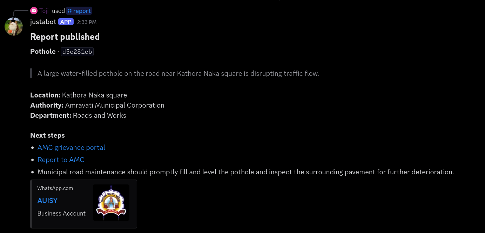
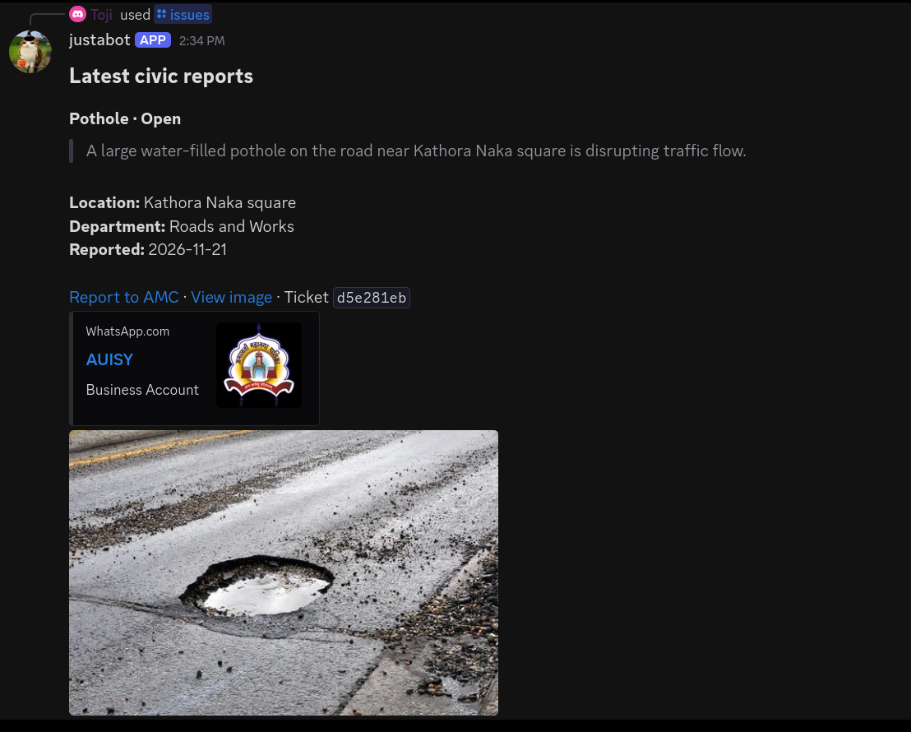
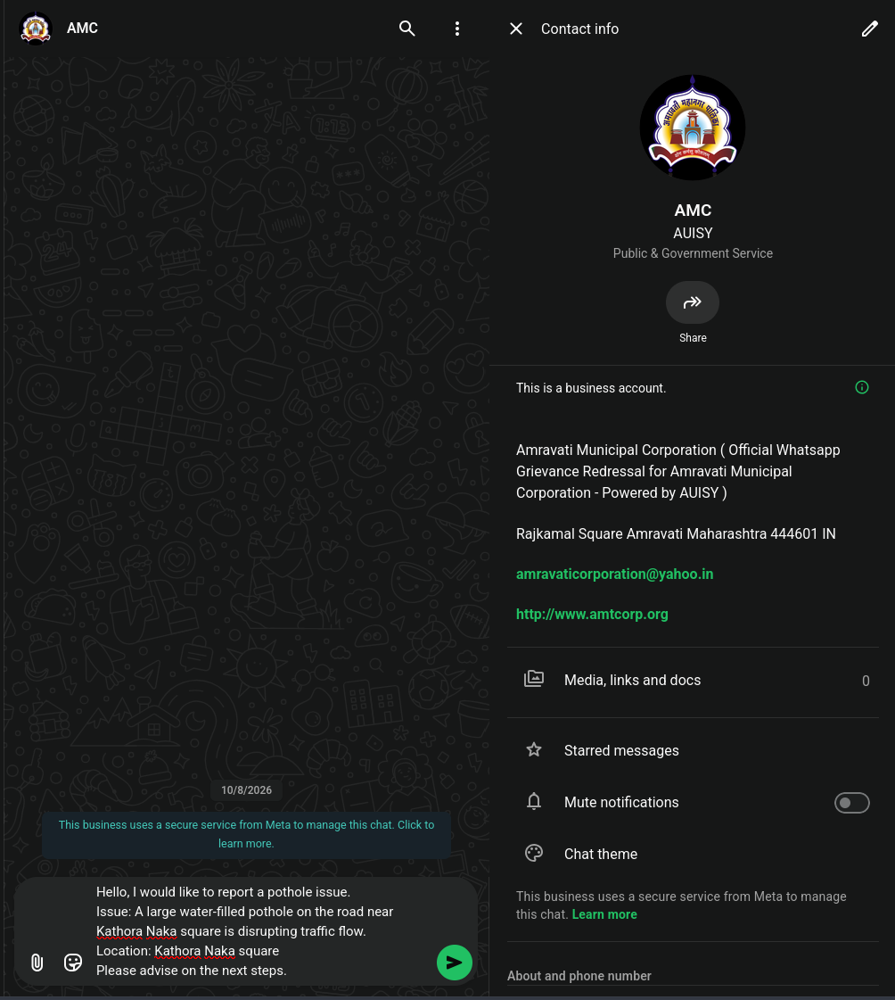

# Civic Sense Bot

Civic Sense is an Amravati-focused Discord bot for reporting local problems such as potholes, broken streetlights, flooding, waste, graffiti, and sidewalk damage. Submitted photos are classified by an OpenAI-compatible vision model, routed to the relevant Amravati Municipal Corporation (AMC) department, and saved in a shared ChromaDB collection that anyone can browse with `/issues`.

## Demo

### Reporting an issue (`/report`)

Classifies the uploaded photo, uses the note for location context, assigns a ticket ID, routes the issue to the appropriate AMC department, and attaches a pre-filled escalation link.



### Browsing open tickets (`/issues`)

Lists recent public reports from persistent ChromaDB storage with status, timestamps, image links, and direct escalation links.



### WhatsApp escalation handoff

Opens the official AMC Business WhatsApp with the formatted complaint details pre-filled. The user reviews the message and presses **Send**; the bot does not send messages automatically.



## Features

- `/report`: analyze and publish a civic issue photo, using the note as location and incident context.
- `/issues`: show the latest public reports and their image links.
- `/edit_ticket`: let the reporter or a server moderator update a ticket's context/location note or status. Severity remains AI-derived.
- Automatic analysis for images posted in a configured home channel (`/set_home_channel`, `/disable_home_channel`).
- `/status`, `/ping`, and `/contacts`.
- Mention the bot or reply to one of its messages to ask a civic question without a slash command. Ordinary chat messages are ignored.
- AMC department routing for roads, electrical, sanitation, water/drainage, health, fire safety, and general civic issues.
- `/contacts` lists official AMC channels (website, grievance portal, WhatsApp, email, office address) and ward-wise Konark sanitation contacts from `Konark_list.pdf`.
- Persistent local database in `memory/` and optional server settings in `data/server_settings.json`.

## Architecture

- [`agent.py`](./agent.py) owns image attachment validation, OpenAI-compatible vision requests, and strict parsing of structured incident reports.
- [`bot.py`](./bot.py) owns Discord commands/events and public ChromaDB persistence.
- [`config.py`](./config.py) is the environment-backed configuration module; secrets are never stored in source control.
- [`ticket.py`](./ticket.py) owns public incident-ticket persistence.
- [`Dockerfile`](./Dockerfile) packages the bot for containerized deployment.
- `data/server_settings.json` (ignored by Git) stores optional per-server home-channel settings at runtime.

## Setup

### Local

1. Install Python 3.10 or newer.
2. Install dependencies:

   ```bash
   python -m pip install -r requirements.txt
   ```

3. Copy `.env.example` to `.env` and fill in your credentials:

   ```env
   DISCORD_BOT_TOKEN=your_discord_bot_token
   AI_API_KEY=your_provider_api_key
   # OpenAI-compatible API endpoint supplied by your provider.
   AI_BASE_URL=https://your-provider.example/v1
   AI_VISION_MODEL=your-vision-model
   ```

   `.env` is ignored by Git and must never be committed.

4. Enable the **Message Content Intent** in the Discord Developer Portal if automatic home-channel analysis is needed.
5. Start the bot:

   ```bash
   python bot.py
   ```

The bot requires permission to view channels, read message history, send messages, and use slash commands.

### Docker

1. Build the image:

   ```bash
   docker build -t civic-bot .
   ```

2. Run the container in detached mode with volume mounts for persistent data:

   ```bash
   docker run -d \
     --name civic-bot \
     --env-file .env \
     -v "$(pwd)/memory:/app/memory" \
     -v "$(pwd)/data:/app/data" \
     civic-bot
   ```

3. View live logs:

   ```bash
   docker logs -f civic-bot
   ```

## Amravati setup

The bot serves **Amravati Municipal Corporation (AMC)** citywide, routing reports by category (for example, potholes to Roads and Works, waste to Sanitation, and flooding to Water Supply and Drainage).

- Official corporation site: [amravaticorporation.in](https://amravaticorporation.in/)
- Official complaint portal: [AMC Complaint Request Entry](https://crm.amravaticorporation.in/)

`/contacts` returns official AMC channels and the ward-wise Konark sanitation contacts from `Konark_list.pdf`. After a report is created, the bot provides an official AMC WhatsApp link with the report details pre-filled for the user to review and send manually.

## Public data and privacy

Reports are intentionally public. The database stores the model-generated summary, category, severity, timestamps, Discord source links, reporter display name, optional note, and original Discord attachment URL. Do not submit private, sensitive, or identifying images.

The local `memory/` directory holds the ChromaDB database and is ignored by Git. Back it up if reports must survive redeployment.

## Development notes

The configured endpoint must support OpenAI-style `image_url` message content. To switch providers, update `AI_API_KEY`, `AI_BASE_URL`, and `AI_VISION_MODEL` in `.env` without modifying the bot code.